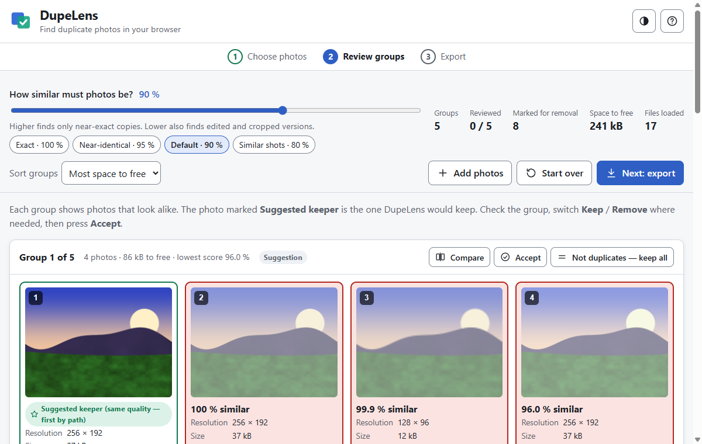
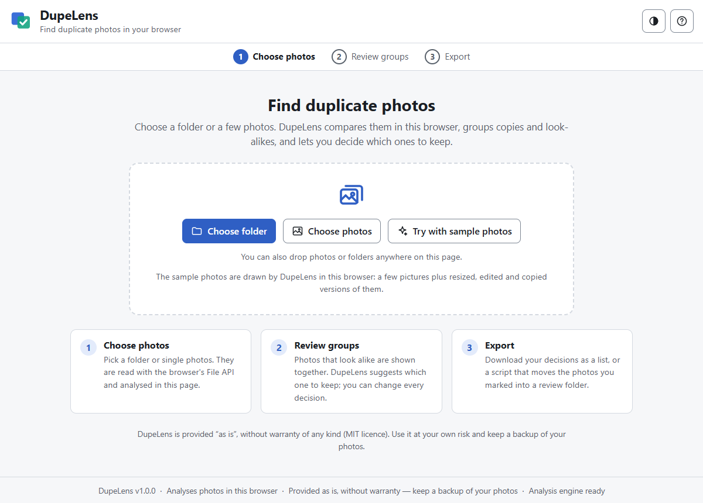
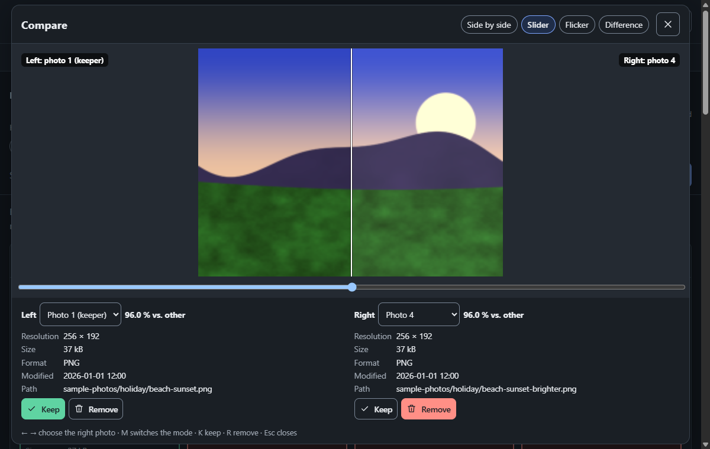

# DupeLens

**Find duplicate and near-duplicate photos in your browser — no installation, with a similarity threshold you control.**

[](LICENSE)
[](https://github.com/NicoBauer1/dupelens/releases)


DupeLens looks through a photo collection, finds exact copies and
near-duplicates — resized, re-saved, lightly edited or slightly cropped
versions of the same picture — groups them, and asks you per group **which
photos to keep**. It is one HTML file: open it, choose a folder, review,
export.



## Features

- **Three simple steps.** 1 Choose photos → 2 Review groups → 3 Export, with
  plain-language labels and a short hint wherever a decision is needed.
- **Try it in seconds.** *Try with sample photos* draws a small synthetic photo
  set in the browser, including resized, edited and copied versions.
- **Your threshold.** "How similar must photos be?" — a slider from 70 to 100 %
  with the presets *Exact*, *Near-identical*, *Default* (90 %) and *Similar
  shots* (80 %). Groups update instantly, without analysing again.
- **A suggestion you can override.** DupeLens proposes one photo per group to
  keep (highest resolution, then larger file, sharper, older) and lets you
  switch every photo between *Keep* and *Remove*, mark a group as *Not
  duplicates* or compare photos side by side, with a slider, flicker or a
  pixel-difference view.
- **Pixel analysis, no machine learning, no cloud.** Every photo is described by
  a handful of transparent fingerprints — SHA-256, three perceptual hashes, a
  colour histogram, SSIM and a sharpness measure — combined into one
  documented similarity score in percent.
- **You decide what happens to your files.** DupeLens itself does not write to
  your files. You get your decisions as JSON or CSV and, optionally, a
  PowerShell or sh script that moves the photos you marked into a review
  folder — dry run first.
- **Keyboard and screen-reader support**, a light and a dark theme, one file
  that works without an internet connection, and zero dependencies.

| Start | Compare (dark theme) |
| --- | --- |
|  |  |

## How it works


1. **Load.** Files come from the file picker, the folder picker or drag and
   drop (folders are walked recursively), or from *Try with sample photos*.
2. **Analyse.** A pool of Web Workers hashes every file with SHA-256, reads the
   image header (size, EXIF orientation), lets the browser decode the image at
   most 256 pixels wide or high and computes its fingerprint. If workers are
   not available, the same code runs on the main thread.
3. **Match.** Every pair is compared. The hash distances give an upper bound of
   the score, so most pairs are rejected after a few bit operations; colour,
   an SSIM bound and the full SSIM follow. All pairs scoring 70 % or more are
   kept.
4. **Group and review.** Moving the slider replays the kept pairs through a
   union-find structure, so regrouping takes milliseconds.
5. **Export.** Decisions and move scripts are generated in the page and offered
   as downloads.

Details: [docs/architecture.md](docs/architecture.md) (modules, worker
protocol, build, performance) and [docs/similarity.md](docs/similarity.md)
(the score and its calibration).

### How DupeLens handles your files

- DupeLens reads the photos with the browser's File API and analyses them in
  the page.
- The page declares a Content-Security-Policy that tells the browser to block
  network connections (`connect-src 'none'`) and remote scripts, styles, fonts
  and images.
- There are no accounts. If you change the colour theme, the page remembers it
  in the browser's `localStorage` (if available); it stores nothing else.
- DupeLens itself does not write to your files. The optional move script moves
  files only when you run it with the apply flag; review it before running it.

## Quick start

### Use the single file

1. Download `dupelens.html` from the
   [latest release](https://github.com/NicoBauer1/dupelens/releases).
2. Open it with a double-click. It works from disk (`file://`) — no
   installation, no server and no internet connection needed.
3. Choose **Try with sample photos** to see how it works, or **Choose folder**
   / **Choose photos** for your own photos. You can also drop photos or folders
   onto the page.
4. Review the groups, then press **Next: export**.

### Run from source

Requires [Node.js](https://nodejs.org/) 22 or newer. There is nothing to
install.

```sh
git clone https://github.com/NicoBauer1/dupelens.git
cd dupelens
npm run serve      # local development server for index.html with ES modules
npm run build      # dist/dupelens.html, the single file
```

## Using DupeLens

### Step 1 — Choose photos

Pick a folder (subfolders included), single photos, or the sample photos.
DupeLens analyses them in parallel and shows the progress; *Cancel* keeps the
photos analysed so far. Files it does not analyse — videos, documents, HEIC
outside Safari — are listed under **Skipped files** with the reason;
byte-identical copies of such files are still found.

### Step 2 — Review groups

Each group is a card with thumbnails and facts (resolution, file size, format,
date, relative path). The photo marked **Suggested keeper** is pre-set to
*Keep*, the others to *Remove*. For each group you can

- switch any photo between **Keep** and **Remove**,
- choose **Not duplicates — keep all**,
- **Accept** the group, or **Undo** back to the suggestion,
- open **Compare** for side by side, slider, flicker or difference views.

The summary above the groups counts groups, reviewed groups, photos marked for
removal and the space that would be freed.

### How similar must photos be? — the threshold

| Similarity | What it finds |
| ---: | --- |
| 100 % (*Exact*) | Exact copies: the same bytes, or the same pixels saved again losslessly |
| 95 % (*Near-identical*) | Resized or re-saved copies, very light edits |
| 90 % (*Default*) | Also brightness or colour edits, small crops (up to about 5 %), an added caption |
| 80 % (*Similar shots*) | Also bigger crops, black-and-white versions, strong colour edits |
| 70 % | The lowest setting; below it unrelated pictures start to match |

Photos are grouped when they are connected by pairs at or above the threshold;
every card shows each photo's score against the suggested keeper. Start with
the default and lower it if you expect edited copies.

### Step 3 — Export

**Next: export** opens step 3 with four downloads:

- `dupelens-decisions-YYYY-MM-DD.json` — groups, decisions, scores, facts and
  skipped files, with a summary.
- `dupelens-decisions-YYYY-MM-DD.csv` — one row per photo (values that would
  start a spreadsheet formula are prefixed with `'`).
- `dupelens-move.ps1` — PowerShell (Windows PowerShell 5.1 and PowerShell 7).
- `dupelens-move.sh` — POSIX sh (macOS, Linux, WSL, Git Bash).

The scripts **move** every photo marked *Remove* into a folder called
`_dupelens_review/`, keeping its relative path, so that you can look through
them before deleting anything yourself. They contain no delete commands, skip a
file whose target already exists, and only print what they would do unless you
add the apply flag. Review a script before you run it.

**Where to run them:** the paths in the scripts are relative to the folder you
loaded *from*. If you chose the folder `C:\Photos\Holiday`, run the script in
`C:\Photos`; if you chose single photos, run it in the folder that contains
them; or pass the folder with `-Root` / `--root`. The export dialog tells you
which case applies.

```powershell
# Windows: dry run, then apply
powershell -ExecutionPolicy Bypass -File .\dupelens-move.ps1
powershell -ExecutionPolicy Bypass -File .\dupelens-move.ps1 -Apply
powershell -ExecutionPolicy Bypass -File .\dupelens-move.ps1 -Root 'C:\Photos' -Apply
```

```sh
# macOS / Linux: dry run, then apply
sh dupelens-move.sh
sh dupelens-move.sh --apply
sh dupelens-move.sh --root ~/Pictures --apply
```

`-ExecutionPolicy Bypass` is needed because Windows blocks downloaded scripts by
default; you can also run `Unblock-File .\dupelens-move.ps1` once. File names
are embedded as literal strings, so names with spaces, quotes, `$`, backticks,
a leading `-` or non-ASCII characters are passed on literally — the unit tests
run both scripts against such names.

### Keyboard shortcuts

Every step works with the keyboard alone (<kbd>Tab</kbd>, <kbd>Enter</kbd>,
<kbd>Space</kbd>, <kbd>Esc</kbd>). In step 2 these shortcuts are available:

| Keys | Action |
| --- | --- |
| <kbd>J</kbd> / <kbd>↓</kbd>, <kbd>K</kbd> / <kbd>↑</kbd> | Next / previous group |
| <kbd>1</kbd> … <kbd>9</kbd> | Switch keep/remove for photo 1–9 of the group |
| <kbd>A</kbd> or <kbd>Enter</kbd> | Accept the group and go to the next one |
| <kbd>N</kbd> | Not duplicates — keep all |
| <kbd>U</kbd> | Undo: back to the suggestion |
| <kbd>C</kbd> | Compare (then <kbd>←</kbd> / <kbd>→</kbd> other photo, <kbd>M</kbd> mode, <kbd>K</kbd> / <kbd>R</kbd> keep / remove) |
| <kbd>T</kbd> | Go to the similarity slider |
| <kbd>E</kbd> | Export |
| <kbd>?</kbd> | Help |

## Known limitations

- **Rotated or mirrored copies** are not detected, and crops above about 10 %
  fall below the default threshold (use *Similar shots*).
- **Formats:** whatever the browser decodes — JPEG, PNG, GIF, WebP, BMP, AVIF
  in most browsers, HEIC and TIFF only in Safari. Other images still take part
  in exact (byte-identical) matching. Videos are skipped.
- **Burst shots and documents:** photos of the same scene taken a moment apart,
  and screenshots or scans with the same layout, can score high. Review such
  groups carefully.
- **Large collections:** analysis scales with the number of CPU cores; matching
  compares all pairs and takes seconds for 10,000 typical photos, longer for
  collections with many look-alikes (see the benchmark in
  [docs/architecture.md](docs/architecture.md#performance)). Everything is kept
  in memory (roughly 5 KB per photo plus the browser's image caches).
- **No saved sessions:** decisions are lost when the tab is closed — export
  them first.
- Scores of the same pair can differ by about one point between browsers,
  because browsers resample images slightly differently.
- Tested with current Chromium-based browsers (Chrome, Edge) at release time;
  the code only uses standard APIs that current Firefox and Safari also
  provide.

## Development and testing

```sh
npm test                         # unit tests (node:test): engine, calibration bands, review state, exports, contrast
npm run build                    # dist/dupelens.html (reproducible, byte-identical builds)
npm run smoke                    # end-to-end check of dist/dupelens.html in headless Chrome or Edge
npm run smoke -- --no-workers    # the same with the main-thread fallback
npm run screenshots              # the README screenshots in docs/images/ (from the sample photos)
npm run calibrate                # score table on the synthetic transform suite
npm run bench                    # matching benchmark (1,000 to 10,000 photos)
npm run samples                  # regenerate examples/ from the sample photo set
```

The move-script tests run the generated sh and PowerShell scripts for real
when a POSIX shell or PowerShell is installed, and are skipped otherwise. The
[`examples/`](examples/) folder contains the sample photos as files, with the
groups DupeLens finds in them.

DupeLens has no dependencies — not at runtime and not for development. The
decisions behind that and the other design choices are recorded in
[docs/adr/](docs/adr/).

## Project structure

```
index.html            development entry point (ES modules)
src/engine/           analysis engine — pure functions, no DOM (runs in Node and workers)
src/app/              user interface, worker pool, review state, compare view, sample photos
src/samples/          synthetic photos drawn from fixed seeds (demo set, calibration suite)
src/export/           JSON/CSV reports and move-script generators
tools/                build, development server, browser smoke test, screenshots, calibration, benchmark
test/                 unit tests (node:test)
examples/             the sample photos as PNG files and their expected groups
docs/                 similarity score, architecture, branching, releasing, decision records, images
```

## Development and security

- DupeLens is maintained by its author only and does not accept issues, pull
  requests or other contributions. The development workflow is described in
  [CONTRIBUTING.md](CONTRIBUTING.md).
- There is no support or reporting channel; the security model is described
  in [SECURITY.md](SECURITY.md).
- Changes per version: [CHANGELOG.md](CHANGELOG.md).

## Disclaimer

DupeLens is provided "as is", without warranty of any kind (see the
[MIT licence](LICENSE)). The descriptions in this repository explain how
DupeLens is meant to work; they are not a guarantee. Use it at your own risk,
review any generated script before running it and keep a backup of your
photos before you move or delete files.

## Licence

[MIT](LICENSE) — Copyright (c) 2026 the project contributors.

Chrome, Edge, Firefox, Safari, Windows, macOS and PowerShell are trademarks of
their respective owners; DupeLens is not affiliated with them.
