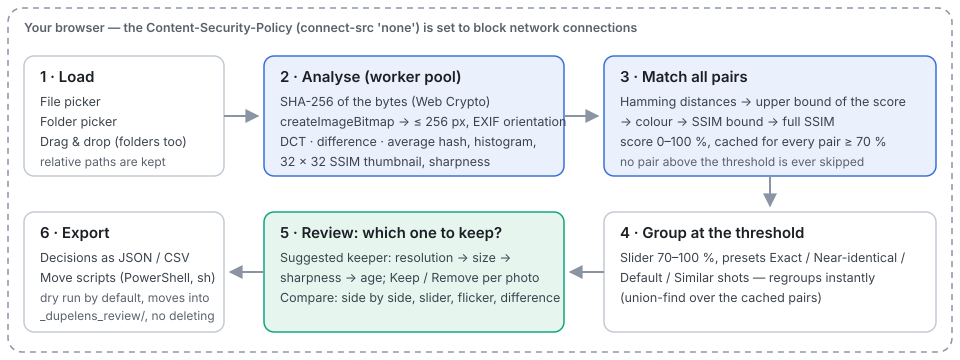

# DupeLens

**Find duplicate and near-duplicate photos in your browser, with a similarity threshold you control.**

[](LICENSE)
[](https://github.com/NicoBauer1/dupelens/releases)


DupeLens looks through a photo collection, finds exact copies and near-duplicates
(resized, re-saved, lightly edited or slightly cropped versions of the same
picture), groups them, and asks you per group **which copies you want to keep**.
It is a single HTML file: open it, drop a folder, review, export.

- **Pixel analysis, no machine learning, no cloud.** Every photo is described by
  a handful of transparent fingerprints (SHA-256, three perceptual hashes, a
  colour histogram, SSIM, a sharpness measure) that are combined into one
  documented similarity score in percent.
- **Your threshold.** A slider from 70 to 100 % with presets — *Exact*,
  *Near-identical*, *Default* (90 %) and *Similar shots* — regroups instantly.
- **You decide what happens.** DupeLens itself does not write to your files.
  You get decisions as JSON/CSV and an optional script that moves the files
  you marked into a review folder — dry run first.



## How DupeLens handles your files

- DupeLens reads the photos with the browser's File API and analyses them in
  the page.
- The page declares a Content-Security-Policy that tells the browser to block
  network connections (`connect-src 'none'`) and remote scripts, styles, fonts
  and images.
- There are no accounts. If you change the colour theme, the page remembers it
  in the browser's `localStorage` (if available); it stores nothing else.
- DupeLens itself does not write to your files. The optional move script moves
  files only when you run it with the apply flag; review it before running it.

## Quick start

### Use the single file

1. Download `dupelens.html` from the [latest release](https://github.com/NicoBauer1/dupelens/releases)
   (or build it yourself with `npm run build`, see below).
2. Open it by double-click. It works from disk (`file://`) — no installation,
   no server, no internet connection needed.
3. Drop a folder onto the page, or use **Choose folder** / **Choose photos**.
4. Review the groups, then **Export**.

### Try it with the examples

The [`examples/`](examples/) folder contains 17 synthetic photos (drawn by a
script, no real pictures) with resized, re-encoded, brightened, cropped,
captioned, greyscale, noisy and rotated variants. Load the folder and compare
with the expected groups listed in [`examples/README.md`](examples/README.md).

### Develop

Requires [Node.js](https://nodejs.org/) 22 or newer. There is nothing to install.

```sh
npm run serve      # local development server for index.html with ES modules
npm test           # unit tests
npm run build      # dist/dupelens.html
```

## Using DupeLens

### The threshold

The score answers "how sure is DupeLens that these two files show the same
picture?". In practice:

| Score | Meaning |
| ---: | --- |
| 100 % | Exact copy: the same bytes, or the same pixels saved again losslessly |
| 97–99.9 % | Same picture as a different file: resized, re-encoded as JPEG |
| 95 % | Lightly edited: brightness, contrast, noise, slight blur |
| 90 % *(default)* | Edited or slightly cropped (up to about 5 %), caption added |
| 80 % | Probably the same scene: bigger crops, greyscale, strong colour edits |
| < 70 % | Different pictures |

Photos are grouped when they are connected by pairs at or above the threshold;
every card shows each photo's score against the group's suggested keeper. The
formula, the calibration table and the known limits are in
[docs/similarity.md](docs/similarity.md).

### Reviewing

Each group is a card with thumbnails and facts (resolution, file size, format,
last-modified date, relative path). DupeLens suggests a keeper —
**highest resolution → larger file → sharper → older** — and pre-selects
*Keep* for it and *Remove* for the other copies. You can

- switch any photo between **Keep** and **Remove**,
- mark a group as **Not duplicates — keep all**,
- **Accept** the group as it is, or **Undo** back to the suggestion,
- open **Compare** for side by side, slider, flicker or pixel-difference views.

The summary at the top counts groups, reviewed groups, files marked for removal
and the space that would be freed. Files that are not analysed (for example
HEIC in browsers other than Safari, videos, documents) are listed under
**Skipped files** with the reason; byte-identical copies of undecodable images
are still found.

### Keyboard shortcuts

| Keys | Action |
| --- | --- |
| <kbd>J</kbd> / <kbd>↓</kbd>, <kbd>K</kbd> / <kbd>↑</kbd> | Next / previous group |
| <kbd>1</kbd> … <kbd>9</kbd> | Toggle keep/remove for photo 1–9 of the group |
| <kbd>A</kbd> or <kbd>Enter</kbd> | Accept the group and go to the next one |
| <kbd>N</kbd> | Not duplicates — keep all |
| <kbd>U</kbd> | Undo: back to the suggestion |
| <kbd>C</kbd> | Compare (in the compare view: <kbd>←</kbd>/<kbd>→</kbd> other photo, <kbd>M</kbd> mode, <kbd>K</kbd>/<kbd>R</kbd> keep/remove) |
| <kbd>T</kbd> | Focus the threshold slider |
| <kbd>E</kbd> | Export |
| <kbd>?</kbd> | Help |

### Exports and the move scripts

**Export** offers four downloads:

- `dupelens-decisions-YYYY-MM-DD.json` — groups, decisions, scores, facts and
  skipped files, with a summary.
- `dupelens-decisions-YYYY-MM-DD.csv` — one row per photo (values
  that would start a spreadsheet formula are prefixed with `'`).
- `dupelens-move.ps1` — PowerShell (Windows PowerShell 5.1 and PowerShell 7).
- `dupelens-move.sh` — POSIX sh (macOS, Linux, WSL, Git Bash).

The scripts **move** every file marked *Remove* into a folder called
`_dupelens_review/`, keeping its relative path, so you can look through them
before deleting anything yourself. They contain no delete commands, skip a file
whose target already exists, and only print what they would do unless you add
the apply flag. Review a script before you run it.

**Where to run them:** the paths in the scripts are relative to the folder you
loaded *from*:

- If you picked or dropped a **folder**, e.g. `C:\Photos\Holiday` or
  `~/Pictures/holiday`, the paths start with `Holiday/…` — run the script in the
  **parent** folder (`C:\Photos`, `~/Pictures`).
- If you picked **individual files**, run it in the folder that contains them.
- Or pass the folder explicitly with `-Root` / `--root`.

The export dialog tells you which case applies.

```powershell
# Windows: dry run, then apply
powershell -ExecutionPolicy Bypass -File .\dupelens-move.ps1
powershell -ExecutionPolicy Bypass -File .\dupelens-move.ps1 -Apply
powershell -ExecutionPolicy Bypass -File .\dupelens-move.ps1 -Root 'C:\Photos' -Apply
```

```sh
# macOS / Linux: dry run, then apply
sh dupelens-move.sh
sh dupelens-move.sh --apply
sh dupelens-move.sh --root ~/Pictures --apply
```

`-ExecutionPolicy Bypass` is needed because Windows blocks downloaded scripts by
default; you can also run `Unblock-File .\dupelens-move.ps1` once. File names
are embedded as literal strings (PowerShell single quotes with doubled quote
characters, sh single quotes with `'\''`), so names with spaces, quotes, `$`,
backticks, a leading `-` or any non-ASCII characters are passed on literally —
the unit tests run both scripts against such names.

## How it works

1. **Load.** Files come from the file picker, the folder picker
   (`webkitdirectory`) or drag and drop (folders are walked recursively).
2. **Analyse.** A pool of Web Workers (sized from
   `navigator.hardwareConcurrency`) hashes every file with SHA-256 (Web Crypto),
   reads the image header (size, EXIF orientation), lets the browser decode the
   image at most 256 pixels wide or high (`createImageBitmap` with
   `imageOrientation: 'from-image'`, `OffscreenCanvas`), and computes the
   fingerprint: DCT hash (own 2D DCT-II), difference hash, average hash, soft
   RGB histogram, a 32 × 32 thumbnail for SSIM and the variance of the
   Laplacian. If workers are not available — some browsers refuse workers on
   `file://` pages — the same code runs on the main thread.
3. **Match.** Every pair is compared. Three Hamming distances already give an
   upper bound of the score, so most pairs are rejected after a few bit
   operations; the colour term and an SSIM bound come next, the full SSIM last.
   No pair above 70 % is ever skipped, and all of them are cached.
4. **Group and review.** Moving the slider only replays the cached pairs
   through a union-find structure — no photo is analysed again.

Details: [docs/architecture.md](docs/architecture.md) (modules, worker
protocol, build, performance) and [docs/similarity.md](docs/similarity.md)
(the score).

## Browser support and limitations

- Tested with current Chromium-based browsers (Chrome, Edge) at release time;
  the code only uses standard APIs that current Firefox and Safari also provide
  (`createImageBitmap`, `OffscreenCanvas`, module workers, `<dialog>`).
- **Formats:** whatever the browser decodes — JPEG, PNG, GIF, WebP, BMP, AVIF
  in most browsers, HEIC and TIFF only in Safari. Undecodable images still take
  part in exact (byte-identical) matching. Videos are skipped.
- **Rotated or mirrored copies** are not detected, and crops above about
  10 % fall below the default threshold (use *Similar shots*).
- **Large collections:** analysis scales with the number of CPU cores;
  matching compares all pairs and takes seconds for 10,000 typical photos,
  longer for collections with many look-alikes (see the benchmark in
  [docs/architecture.md](docs/architecture.md#performance)). Everything is kept
  in memory (roughly 5 KB per photo plus the browser's own image caches).
- Decisions are lost when the tab is closed — export them.
- `?workers=0` appended to the page URL forces the main-thread mode.

## Project structure

```
index.html            development entry point (ES modules)
src/engine/           analysis engine — pure functions, no DOM (runs in Node and workers)
src/app/              user interface, worker pool, review state, compare view
src/export/           JSON/CSV reports and move-script generators
tools/                build, development server, samples, calibration, benchmark, browser smoke test
test/                 unit tests (node:test)
examples/             synthetic demo photos and their expected groups
docs/                 similarity score, architecture, branching, releasing, decision records
```

## Testing

```sh
npm test                         # all unit tests, incl. calibration bands and script runs
npm run build                    # dist/dupelens.html (reproducible, byte-identical builds)
npm run calibrate                # score table on the synthetic transform suite
npm run bench                    # matching benchmark (1,000 to 10,000 photos)
npm run samples                  # regenerate examples/
npm run smoke                    # end-to-end check of dist/dupelens.html in headless Chrome or Edge
```

The move-script tests run the generated sh and PowerShell scripts for real
when a POSIX shell or PowerShell is installed, and are skipped otherwise.

## Development and security

- DupeLens is maintained by its author only and does not accept issues, pull
  requests or other contributions. The development workflow is described in
  [CONTRIBUTING.md](CONTRIBUTING.md).
- There is no support or reporting channel; the security model is described
  in [SECURITY.md](SECURITY.md).
- Changes per version: [CHANGELOG.md](CHANGELOG.md).

## Disclaimer

DupeLens is provided "as is", without warranty of any kind (see the
[MIT licence](LICENSE)). The descriptions in this repository explain how
DupeLens is meant to work; they are not a guarantee. Use it at your own risk,
review any generated script before running it and keep a backup of your
photos before you move or delete files.

## Licence

[MIT](LICENSE) — Copyright (c) 2026 the project contributors.

Chrome, Edge, Firefox, Safari, Windows, macOS and PowerShell are trademarks of
their respective owners; DupeLens is not affiliated with them.
