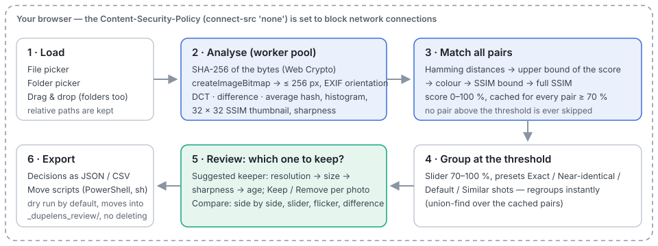

# Architecture

DupeLens is a static web page. There is no server component: the page reads
the files the user selects, analyses them with the browser's own decoders and
a small JavaScript engine, and offers downloads. This page describes how the
code is organised and why. Decisions are recorded in [the ADRs](adr/).



## Modules

```
src/engine/          pure analysis code, no DOM — runs in workers, on the main thread and in Node
  sha256.js          Web Crypto digest with a pure JavaScript fallback
  imageinfo.js       format, size and EXIF orientation from the file header
  raster.js          alpha over white, luma, area-averaging resampler
  dct.js             orthonormal 2D DCT-II (and inverse, used by the test tools)
  hashes.js          average, difference and DCT hash (64 bit each)
  histogram.js       soft-binned RGB histogram, histogram intersection
  ssim.js            SSIM on 32 × 32 thumbnails, block sums, upper bound
  sharpness.js       variance of the Laplacian
  fingerprint.js     decoded pixels → fingerprint
  similarity.js      fingerprint pair → score 0–100 (see similarity.md)
  matcher.js         all pairs with an exact pruning bound
  grouping.js        union-find, pair index
  keeper.js          keeper suggestion and its reason
  bits.js            64-bit hashes as two 32-bit words, popcount
src/app/             browser application
  main.js            controller: loading, progress, review rendering, keyboard, export dialog
  review.js          review state (groups, keeper, decisions, summary, report) — DOM-free, unit-tested
  pool.js            worker pool with main-thread fallback
  worker.js          worker entry point
  worker-factory.js  how a worker is created (replaced in the single-file build)
  analyse-file.js    read → SHA-256 → header → decode → fingerprint (worker and main thread)
  loader.js          file picker, folder picker, drag and drop (recursive folders)
  compare.js         compare dialog (side by side, slider, flicker, difference)
  dom.js, icons.js, format.js, version.js, styles.css
src/export/
  report.js          JSON and CSV reports
  scripts.js         PowerShell and sh move scripts, quoting
```

The engine does not import from `src/app/`. `review.js` and everything in
`src/export/` are free of DOM access as well, so the whole decision logic is
covered by Node tests.

## Data flow

1. **Loading** (`loader.js`). The file picker and the folder picker
   (`<input webkitdirectory>`) return `File` objects with
   `webkitRelativePath`; drag and drop uses `DataTransferItem.webkitGetAsEntry()`
   and walks directories recursively (`readEntries` is called until it returns
   an empty batch). Every file keeps a forward-slash relative path. Files that
   were already loaded (same path, size and date) are ignored when photos are
   added later.
2. **Analysis** (`pool.js`, `worker.js`, `analyse-file.js`). Each file is read
   once (`File.arrayBuffer()`), hashed with SHA-256, and its header is parsed.
   Videos, SVGs and unknown files are skipped with a reason. Images are decoded
   with `createImageBitmap(blob, { resizeWidth, resizeQuality: 'high',
   imageOrientation: 'from-image' })` — only the width is given, so the aspect
   ratio is kept whether a browser resizes before or after applying the EXIF
   orientation — drawn onto an `OffscreenCanvas` and read back with
   `getImageData`. If the browser does not decode the file (HEIC outside Safari,
   damaged files), the file is kept for exact matching only.
3. **Fingerprint** (`fingerprint.js`). RGBA pixels (longer side ≤ 256 px) →
   hashes, histogram, 32 × 32 thumbnail, sharpness: about 5 KB per photo.
   Typed arrays are transferred, not copied, back to the page.
4. **Matching** (`matcher.js`). All pairs are compared in time slices of about
   40 ms with a pause in between, so the page stays responsive and shows
   progress. Every pair scoring at least 70 % is kept.
5. **Review** (`review.js`, `main.js`). The threshold slider replays the cached
   pairs through union-find. Group cards are rendered 20 at a time when the end
   of the list comes into view (IntersectionObserver). Thumbnails are object
   URLs of the original files with `loading="lazy"`, so the browser decodes only
   what is visible.
6. **Export** (`report.js`, `scripts.js`). Downloads are created from Blobs; the
   page does not write to disk itself.

## Worker protocol

```
page → worker   { type: 'ping' }
worker → page   { type: 'pong', canDecode }          OffscreenCanvas + createImageBitmap available?
page → worker   { type: 'analyse', id, file, name }   File is structured-cloned (no copy of the bytes)
worker → page   { type: 'result', id, result }        fingerprint arrays are transferred
worker → page   { type: 'error', id, message }
```

The pool starts `min(8, hardwareConcurrency − 1)` workers (at least one) and
keeps two jobs in flight per worker. A worker that does not answer the ping
within four seconds, or does not decode, is dropped; if none is left, the files
are analysed on the main thread one by one with a pause after each file. The
footer shows which mode is active; `?workers=0` forces the main-thread mode for
testing.

## Security model

- **Content-Security-Policy.** Development (`index.html`): `default-src 'none';
  script-src 'self'; style-src 'self'; img-src 'self' blob: data:; worker-src
  'self' blob:; connect-src 'none'; base-uri 'none'; form-action 'none';
  object-src 'none'`. The development server sends the same policy as a header
  (plus `frame-ancestors 'none'`). The single file uses hashes instead of
  `'self'`: `script-src 'sha256-…'; style-src 'sha256-…'; img-src blob: data:;
  worker-src blob:; connect-src 'none'; …`. Workers inherit the policy.
- **No markup from data.** File names and paths are inserted with
  `textContent`/attributes only; icons are built with DOM APIs. There is no
  `innerHTML`, no `eval`, no inline event handler.
- **Downloads only.** Scripts use literal quoting for every path (see
  `scripts.js` and its tests) and are dry runs unless the user adds the apply
  flag. They move files, contain no delete commands and skip existing targets.
- **Development server** listens on the loopback interface only, serves files inside the
  repository only (path normalisation, `..` and NUL rejected) and sends
  `nosniff`, `no-referrer` and `no-store` headers.

## The single-file build

`npm run build` (`tools/build.mjs`) produces `dist/dupelens.html`:

1. The worker entry (`src/app/worker.js`) and the app entry (`src/app/main.js`)
   are bundled separately by an in-house bundler. Each ES module becomes a
   function scope that returns its exports; imports become destructuring
   assignments; modules are emitted in dependency order. Supported syntax:
   `import { a, b } from './x.js'` and exported declarations. Default exports,
   re-exports, `import * as`, renamed imports, dynamic `import()` and
   `import.meta` are rejected with an error.
2. `src/app/worker-factory.js` is replaced by a version that embeds the worker
   bundle as a string and starts it from a Blob URL.
3. The CSS and the app bundle are inlined into `index.html`, and the
   Content-Security-Policy is rewritten with the SHA-256 hashes of the inline
   script and style.
4. Line endings are normalised and nothing time-dependent is included, so the
   output is byte-identical on every machine; the tests build twice and compare.

Opening the file from disk works in Chromium-based browsers with Blob-URL
workers (checked by `tools/smoke-browser.mjs`); browsers that refuse workers
on `file://` fall back to the main thread.

## Performance

### Matching

`npm run bench` (`tools/bench.mjs`) times the matcher on synthetic fingerprints
(Node 24 on one core of a 4-core laptop CPU; the browser runs
the same code on the main thread):

| Photos | Collection | Pairs | Rejected by hashes | Full SSIM | Pairs ≥ 70 % | Matching | Regroup at 90 % |
| ---: | --- | ---: | ---: | ---: | ---: | ---: | ---: |
| 1,000 | random | 0.5 M | 99.6 % | 269 | 255 | 0.04–0.15 s | 1–3 ms |
| 5,000 | random | 12.5 M | 99.6 % | 1,381 | 1,126 | 0.4–0.8 s | 2–6 ms |
| 10,000 | random | 50.0 M | 99.6 % | 3,278 | 2,402 | 1.1–3.1 s | 2–5 ms |
| 1,000 | stress | 0.5 M | 71.1 % | 21,802 | 1,828 | 0.2–0.6 s | 1 ms |
| 5,000 | stress | 12.5 M | 70.5 % | 539,207 | 41,124 | 6–16 s | 3–6 ms |
| 10,000 | stress | 50.0 M | 70.6 % | 2,194,582 | 168,358 | 33–64 s | 5 ms |

- *random*: unrelated photos have independent hash bits (about 32 of 64 bits
  differ); 20 % of the photos are in near-duplicate clusters of 2–4.
- *stress*: every photo shares a common layout, so unrelated hashes differ in
  only about 27 (DCT) and 16 (average hash) bits, and 0.3 % of all pairs score
  above 70 % — about 34 "near matches" per photo, far more than a real
  library. It shows the worst case of the prefilter.
- Ranges are the spread over several runs on a laptop on battery power, with
  and without other programs running; the lower values are from the quieter
  runs.
- Matching runs in time slices of about 40 ms, so even the slow cases keep the
  page responsive and show progress.

Regrouping when the slider moves takes milliseconds in every case, because
only the cached pairs are replayed.

### Analysis

Analysis time is dominated by the browser's image decoder (a 12-megapixel JPEG
takes tens of milliseconds to decode even at reduced size) and scales with the
number of workers. Fingerprinting a decoded 256-pixel image takes about 15 ms
in Node (`computeFingerprint`); the whole synthetic `examples/` folder is
analysed in well under a second.

### Memory

About 5 KB of fingerprint data per photo (32 × 32 float thumbnail, 64-bin
histogram, three hashes, SSIM window statistics) — 50 MB for 10,000 photos —
plus 40 bytes per cached pair and the browser's caches for visible thumbnails.
